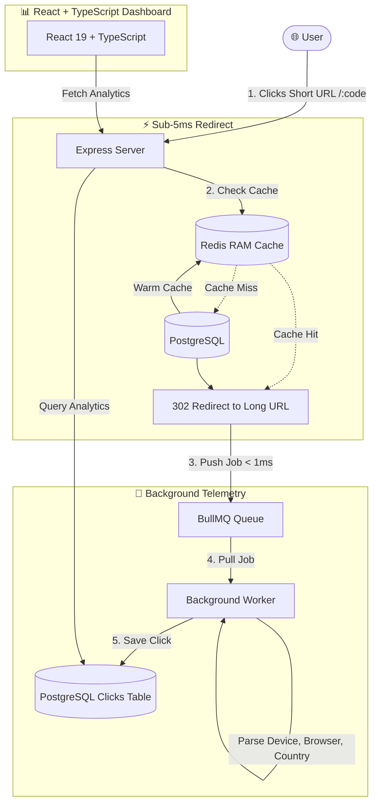

# ⚡ PulseLink — Full-Stack URL Shortener & Telemetry Dashboard

[](https://www.typescriptlang.org/)
[](https://react.dev/)
[](https://nodejs.org/)
[](https://www.postgresql.org/)
[](https://redis.io/)
[](https://bullmq.io/)
[](https://tailwindcss.com/)
[](https://www.docker.com/)

PulseLink is a modern, full-stack URL shortener and real-time click telemetry platform. Built with **React 19, TypeScript, Node.js, PostgreSQL, Redis, and BullMQ**, it demonstrates how to build high-performance web applications using caching, asynchronous background job queues, and end-to-end type safety.

---

## 🎯 Key Highlights

- **⚡ Fast Redirects with Redis Caching**: Redirects are cached in Redis RAM for sub-5ms response times.
- **📨 Asynchronous Click Telemetry**: Click tracking is sent to a **BullMQ** background queue, so logging visitor analytics never slows down the user's redirect.
- **🛡️ Full TypeScript Frontend**: Built with React 19 and strict TypeScript, ensuring zero runtime type errors and complete interface contracts for analytics data.
- **📊 Real-Time Analytics Dashboard**: Visualizes click traffic over time (hourly area chart) and breakdowns by **Country**, **Device**, **Browser**, and **Referrer** using Recharts.
- **🔒 Rate Limiting**: Redis-powered rate limiter prevents spam (5 link creations per minute per IP).
- **📱 Instant QR Codes**: Generates downloadable/scannable SVG QR codes for any created short link directly in the browser.
- **🐳 Dockerized Development**: One-command setup for PostgreSQL and Redis using Docker Compose.

---

## 🏗️ How It Works (Architecture)



---

## 🛠️ Tech Stack

| Layer | Technologies Used |
|---|---|
| **Frontend** | React 19, **TypeScript**, Vite, Tailwind CSS v4, Recharts, Lucide Icons, QRCode.react |
| **Backend** | Node.js, Express.js (REST API, ES Modules) |
| **Database** | PostgreSQL 16 (Relational DB for URLs and Clicks) |
| **Cache & Queue** | Redis 7 (Caching & Rate Limiting), BullMQ (Background Jobs) |
| **DevOps / Infra** | Docker, Docker Compose, Git |

---

## 💻 Frontend & TypeScript Implementation

The frontend is written in **100% TypeScript (`.tsx` / `.ts`)** to enforce reliability:
- **Centralized Data Models (`src/types/analytics.ts`)**: Defines strict `interface` contracts for URLs, click summaries, timeline points, and breakdown stats.
- **Type-Safe Component Props**: Every component (`Navbar`, `UrlShortener`, `AnalyticsSummary`, `AnalyticsCharts`) has typed input props to prevent runtime bugs.
- **Optimistic UI Updates**: Immediately updates the active link chip on click for zero perceived lag while data loads.
- **Live Polling Toggle**: Allows switching on 3-second live polling to watch incoming clicks in real time.

---

## 🚀 Getting Started

### Prerequisites
- [Node.js (v20+)](https://nodejs.org/) & npm
- [Docker Desktop](https://www.docker.com/)

### 1. Clone the Repository
```bash
git clone https://github.com/akshaykp123/pulselink.git
cd pulselink
```

### 2. Start PostgreSQL & Redis
Run Docker Compose in the project root:
```bash
docker compose up -d
```
*(This starts PostgreSQL on port `5432` and Redis on port `6379`.)*

### 3. Run the Backend
```bash
cd backend
npm install
npm run dev
```
> Server will start at **http://localhost:5000**

### 4. Run the Frontend
In a new terminal window:
```bash
cd frontend
npm install
npm run dev
```
> Frontend will open at **http://localhost:5173**

---

## 📡 API Endpoints

| Method | Endpoint | Description |
|---|---|---|
| `POST` | `/api/urls` | Shorten a long URL (accepts optional `customAlias`) |
| `GET` | `/:code` | Redirect to original long URL (cached via Redis) |
| `GET` | `/api/urls/:code/analytics` | Get total clicks, unique visitors, timeline, and breakdowns |
| `GET` | `/api/urls` | Get list of recent shortened URLs |

---

## 📁 Project Structure

```text
pulselink/
├── backend/
│   ├── src/
│   │   ├── config/          # PostgreSQL & Redis connection configs
│   │   ├── controllers/     # URL and Redirect controllers
│   │   ├── middleware/      # Redis rate limiter
│   │   ├── queues/          # BullMQ telemetry job queue
│   │   ├── utils/           # Base62 encoder & IP/Device parsers
│   │   ├── workers/         # BullMQ background worker
│   │   └── server.js        # Express app entrypoint
│   └── docker-compose.yml   # PostgreSQL + Redis setup
│
├── frontend/
│   ├── src/
│   │   ├── components/      # Navbar, UrlShortener, AnalyticsSummary, AnalyticsCharts
│   │   ├── types/           # Centralized TypeScript interfaces (analytics.ts)
│   │   ├── App.tsx          # Main dashboard view
│   │   ├── main.tsx         # React entrypoint
│   │   └── vite-env.d.ts    # Vite type declarations
│   ├── tsconfig.json        # TypeScript configuration
│   └── package.json         # React 19 + TypeScript dependencies
└── README.md
```

---

## 🛡️ Security & Reliability

- **Rate Limiting**: Protects URL generation with Redis sliding counters.
- **Privacy First**: Client IPs are hashed with SHA-256 before storing analytics.
- **SQL Injection Protection**: Uses parameterized queries (`$1, $2`) for all database operations.
- **Type Safety**: Frontend catches errors at build time with `tsc --noEmit`.

---

## 📄 License
This project is open-source under the [MIT License](LICENSE).
