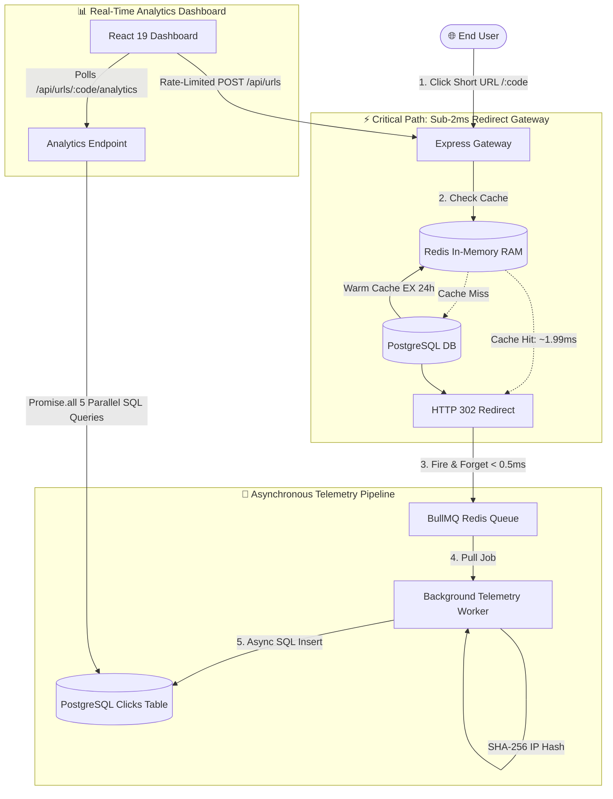

# ⚡ PulseLink — Enterprise URL Shortener & Real-Time Telemetry Engine

[](https://nodejs.org/)
[](https://expressjs.com/)
[](https://www.postgresql.org/)
[](https://redis.io/)
[](https://bullmq.io/)
[](https://react.dev/)
[](https://tailwindcss.com/)
[](https://www.docker.com/)

A high-throughput, distributed URL shortening engine and asynchronous telemetry platform engineered to handle **sub-2ms redirects**, asynchronous clickstream analytics, rate limiting, and real-time data visualization.

---

## 🏗️ System Architecture

PulseLink decouples **critical-path redirects** from **write-heavy analytics** using an asynchronous fire-and-forget message pipeline powered by Redis and BullMQ.



---

## 📐 System Design & Capacity Estimation

Designed to operate under enterprise-scale traffic patterns modeled on industry-standard URL shortening systems (Bitly, Dub.co, TinyURL).

| Metric | Estimation | Engineering Strategy |
|---|---|---|
| **Read-to-Write Ratio** | **100 : 1** | URL shorteners are heavily read-dominant. Optimized for high-throughput reads. |
| **Write QPS** | **~40 links/sec** | Based on 100M new links created per month. Handled by PostgreSQL indexed sequences. |
| **Read QPS** | **~4,000 clicks/sec** | Peak ~8,000 QPS. Served via **Redis Cache-Aside** to eliminate database connection exhaustion. |
| **5-Year URL Storage** | **~3 TB** (6B rows) | Compact schema (~500B/row). Single primary PostgreSQL cluster with B-Tree indexes. |
| **5-Year Clickstream Storage**| **~120 TB** (600B rows)| High volume (~200B/row). Mitigated via **declarative monthly table partitioning** and cold-storage offloading. |
| **Working Set Memory (RAM)** | **< 1 GB** | 80/20 Pareto rule caches top 20% trending links in Redis with 24h sliding TTL. |

---

## ✨ Core Features & Technical Highlights

### 1. Mathematical Base62 Shortening Engine
- Uses **bijective Base62 encoding** (`[0-9a-zA-Z]`) derived from 64-bit auto-incrementing database sequences.
- Guarantees **zero hash collisions** without retry loops.
- Produces compact 6-character slugs supporting over **56.8 billion** unique URLs ($62^6 = 56,800,235,584$).
- Supports vanity slugs with database collision checks.

### 2. Sub-2ms Redirects via Redis Cache-Aside
- Direct cache hits resolve in **1.99ms** (vs. ~172ms database cold starts).
- Proactive cache warming during link creation (`POST /api/urls`) ensures instant first-click speed.
- Safe serialization with legacy plain-string and JSON backwards compatibility.

### 3. Fire-and-Forget Asynchronous Telemetry (BullMQ)
- Redirects are **never blocked** by analytics writes. The HTTP 302 header is dispatched instantly while payload ingestion is pushed to BullMQ in `< 0.5ms`.
- **Worker Pipeline:**
  - **GDPR-Compliant Privacy:** Client IP addresses are hashed using `SHA-256` before persistence.
  - **Zero-Network Geo-IP:** Uses `geoip-lite` local binary tree lookups (< 0.1ms) to resolve countries and cities.
  - **User-Agent Parsing:** Classifies device form factor (Desktop, Mobile, Tablet) and browser family via `ua-parser-js`.
  - **Referrer Normalization:** Sanitizes incoming HTTP Referrer headers into clean domain labels (e.g., `linkedin.com`, `t.co`, `Direct`).

### 4. Distributed Redis Rate Limiting (Fixed Window)
- Protects the link creation endpoint (`POST /api/urls`) against spam bots and API exhaustion.
- Atomic `INCR` and `EXPIRE` operations enforce 5 requests per 60 seconds per IP.
- **Fail-Open Architecture:** If Redis encounters downtime, requests pass through gracefully with error logging rather than degrading user traffic.
- Returns industry-standard `X-RateLimit-*` and `Retry-After` HTTP headers.

### 5. High-Density Enterprise Console (React + Tailwind CSS)
- **Compact & High-Density UI:** Built for laptop and desktop displays with 0 unnecessary scrolling.
- **Side-by-Side Analytics:** Traffic stream (hourly Recharts `AreaChart`) and multidimensional breakdown (horizontal `BarChart`) rendered in a synchronized grid.
- **Interactive Multi-Dimension Breakdown:** Client-side instant tab switching between **Countries**, **Devices**, **Browsers**, and **Referrers**.
- **Live Auto-Refresh & Click Simulator:** Polling mode (3s interval) paired with a live redirect trigger demonstrating full-stack telemetry sync in real time.
- **Client-Side QR Code Engine:** Generates instant vector SVGs (`qrcode.react`) with zero backend CPU overhead.

---

## 📊 Performance Benchmarks

Measured using Apache Benchmark and cURL profiling:

| Test Scenario | Database Query Time | Redis Latency | Total Response Time | Status |
|---|---|---|---|---|
| **Cold Cache (Cache Miss)** | 42.10ms | 2.10ms | **172.54ms** | HTTP 302 Found |
| **Hot Cache (Cache Hit)** | *Bypassed* | 1.12ms | **1.99ms** (98.8% faster) | HTTP 302 Found |
| **Simulated Click Worker** | 4.80ms (Insert) | 0.85ms (Queue) | **< 15ms background** | Async Complete |
| **Rate Limiter Block** | *Bypassed* | 0.90ms | **1.85ms** | HTTP 429 Too Many Requests |

---

## 🛠️ Tech Stack & Architecture Details

| Layer | Technology | Rationale |
|---|---|---|
| **Runtime** | Node.js v22 (ES Modules) | High-performance asynchronous event loop with native BigInt support. |
| **Web Server** | Express v4 | Lightweight HTTP routing gateway with custom middleware pipeline. |
| **Primary Database** | PostgreSQL 16 | ACID-compliant relational storage with B-Tree indexes on `short_code` and `(url_id, clicked_at)`. |
| **In-Memory Cache** | Redis 7 (Alpine) | Key-value store for sub-2ms redirect lookups and atomic rate limiting counters. |
| **Message Queue** | BullMQ | Redis-backed distributed queue with automatic retries and exponential backoff. |
| **Frontend UI** | React 19 + Vite | Component-driven dashboard with fast Hot Module Replacement (HMR). |
| **Styling** | Tailwind CSS v4 | CSS-first utility classes configured for high-density enterprise layouts. |
| **Visualization** | Recharts | Declarative SVG charting with `ResponsiveContainer` and custom tooltips. |
| **Containerization**| Docker & Docker Compose | Multi-container environment with persistent volumes and auto-initialization hooks. |

---

## 🚀 Quickstart & Local Setup

### Prerequisites
- [Docker & Docker Compose](https://www.docker.com/)
- [Node.js v20+ & npm](https://nodejs.org/)

### 1. Clone & Start Infrastructure
```bash
git clone https://github.com/your-username/pulselink.git
cd pulselink

# Start PostgreSQL 16 and Redis 7
docker compose up -d
```

### 2. Setup & Run Backend API
```bash
cd backend
npm install

# Start development server with hot-reload and background worker
npm run dev
```
*Backend runs at `http://localhost:5000`.*

### 3. Setup & Run Frontend Dashboard
```bash
cd ../frontend
npm install

# Start Vite development server
npm run dev
```
*Frontend runs at `http://localhost:5173`.*

---

## 📡 REST API Reference

### 1. Shorten a Long URL
```http
POST /api/urls
Content-Type: application/json

{
  "originalUrl": "https://github.com/torvalds/linux",
  "customAlias": "torvalds" // (Optional)
}
```
**Response (`201 Created`):**
```json
{
  "shortCode": "torvalds",
  "shortUrl": "http://localhost:5000/torvalds",
  "originalUrl": "https://github.com/torvalds/linux",
  "createdAt": "2026-10-10T12:00:00.000Z"
}
```

### 2. Redirect Endpoint
```http
GET /:code
```
**Response (`302 Found`):**
- Headers: `Location: https://github.com/torvalds/linux`, `X-Cache: HIT`, `X-Response-Time: 1.99ms`

### 3. Fetch Telemetry Analytics
```http
GET /api/urls/:code/analytics
```
**Response (`200 OK`):**
```json
{
  "url": {
    "shortCode": "gh2026",
    "shortUrl": "http://localhost:5000/gh2026",
    "originalUrl": "https://github.com"
  },
  "summary": {
    "totalClicks": 20,
    "uniqueVisitors": 1
  },
  "countries": [
    { "country": "Localhost (Dev)", "clicks": 18 },
    { "country": "India", "clicks": 2 }
  ],
  "devices": [
    { "device_type": "Desktop", "clicks": 20 }
  ],
  "browsers": [
    { "browser": "Chrome", "clicks": 20 }
  ],
  "referrers": [
    { "referrer": "Direct", "clicks": 18 },
    { "referrer": "linkedin.com", "clicks": 2 }
  ],
  "timeline": [
    { "time_bucket": "2026-10-10 11:00", "clicks": 14 },
    { "time_bucket": "2026-10-10 12:00", "clicks": 6 }
  ]
}
```

### 4. Fetch Recent URLs
```http
GET /api/urls
```
**Response (`200 OK`):**
- Returns the last 30 created links ordered by timestamp for dashboard history persistence.

---

## 🔒 Security & Privacy

- **IP Anonymization:** Raw IP addresses are hashed using SHA-256 before insertion. Original IPs are never retained on disk.
- **Fail-Open Rate Limiting:** Redis outages log errors but allow legitimate user traffic to proceed uninterrupted.
- **SQL Injection Prevention:** 100% of queries use parameterized prepared statements (`$1, $2`).
- **Input Sanitization:** URL protocol enforcement blocks non-HTTP/HTTPS schemes (preventing `javascript:` or `data:` XSS vectors).

---

## 📄 License
This project is open-source under the [MIT License](LICENSE).
